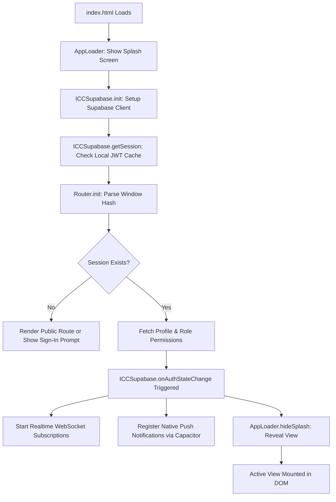
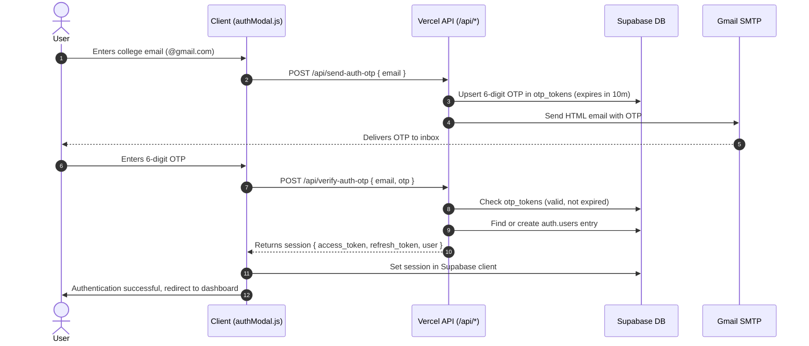
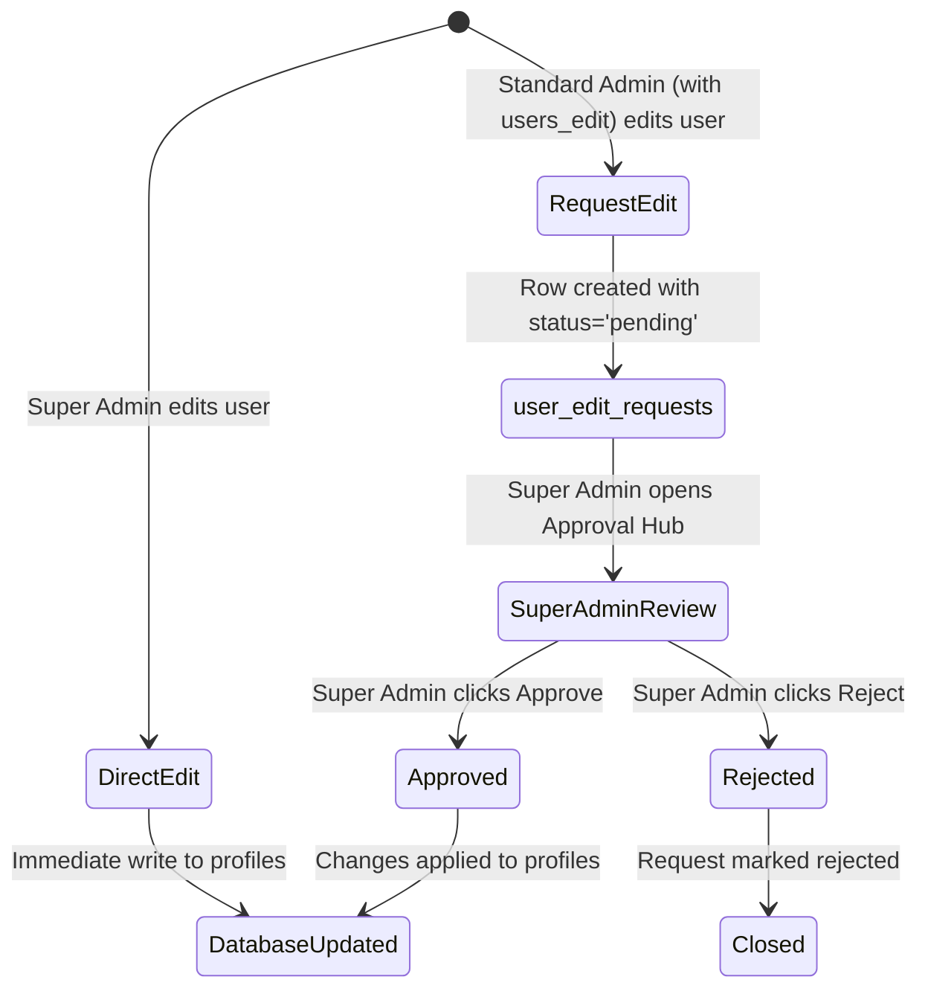

# ICC Social Hub — Complete Technical Architecture & Developer Handbook

> **Target Audience:** Software Engineers, Full-Stack Developers, and System Administrators joining or maintaining the ICC Social Hub project.  
> **Goal:** Provide an immediate, comprehensive, and exhaustive technical breakdown of the entire platform—from architecture, technology stack, directory layout, database schema, and security models to function-by-function API references and step-by-step developer modification workflows.

---

## Table of Contents
1. [Executive System Overview](#1-executive-system-overview)
2. [Technology Stack & Core Dependencies](#2-technology-stack--core-dependencies)
3. [Repository Directory & File Structure](#3-repository-directory--file-structure)
4. [High-Level Architecture & Lifecycle Flow](#4-high-level-architecture--lifecycle-flow)
5. [Authentication & Session Engine](#5-authentication--session-engine)
6. [Role-Based Access Control (RBAC) & Permission System](#6-role-based-access-control-rbac--permission-system)
7. [Comprehensive Function & Module Reference](#7-comprehensive-function--module-reference)
   - [7.1. Database & Core Client API (`js/supabase.js`)](#71-database--core-client-api-jssupabasejs)
   - [7.2. SPA Router & Lifecycle Controller (`js/router.js` & `js/app.js`)](#72-spa-router--lifecycle-controller-jsrouterjs--jsappjs)
   - [7.3. Views Layer (`js/views/`)](#73-views-layer-jsviews)
   - [7.4. UI Components Layer (`js/components/`)](#74-ui-components-layer-jscomponents)
   - [7.5. Serverless Backend Endpoints (`api/`)](#75-serverless-backend-endpoints-api)
8. [Database Architecture & Schema Reference](#8-database-architecture--schema-reference)
9. [Android & Capacitor Hybrid Architecture](#9-android--capacitor-hybrid-architecture)
10. [Local Development & Deployment Guide](#10-local-development--deployment-guide)
11. [Developer Rules, Gotchas & Extension Guide](#11-developer-rules-gotchas--extension-guide)

---

## 1. Executive System Overview

**ICC Social Hub** (Innovators Creators Club Hub) is a hybrid cross-platform application (Web SPA + Native Android APK via Capacitor) designed for a college innovation club. It acts as a comprehensive portal combining:
1. **Club Community Feed**: Public posts, multimedia attachments, likes, threaded comments, and content moderation.
2. **Direct & Team Messaging**: Real-time 1-on-1 direct chat and team-specific discussion channels backed by Supabase WebSocket subscriptions.
3. **Teams & Core Leadership Directory**: Interactive club divisions, member listings, application workflows, and appointed lead profiles.
4. **Events & Calendar Management**: Club events, RSVP/registration tracking, agendas, and detail pages.
5. **Component & Hardware Inventory**: Hardware kit tracking, item stock counters, component borrow requests, and admin approval workflows.
6. **Attendance Tracking**: Event and meeting check-in logging with search, filtering, and Excel export.
7. **Administrative Command Center**: Two-tier governance:
   - **Super Admin**: Permanent full authority, user edit request approvals, appointing/revoking admins, immutable permissions.
   - **Standard Admin**: Configurable access to 6 distinct permission switches (`broadcast`, `moderate`, `events`, `leads`, `users_edit`, `users_export`).
   - **Two-Tier Approval Hub**: Standard admins submit member profile edits as requests; Super Admins review, diff, and approve or reject them.

---

## 2. Technology Stack & Core Dependencies

### Frontend (Client-Side)
- **Vanilla JavaScript (ES6+)**: Modular IIFE/revealing-module pattern (`const ViewName = (() => { ... return { mount, unmount }; })()`). No heavy framework runtime overhead; ultra-fast load times.
- **Tailwind CSS (via CDN)**: Utility-first styling supplemented by custom glassmorphism styles in `css/styles.css`.
- **SheetJS (`xlsx`)**: Client-side parsing and generation of `.xlsx` spreadsheets for student roster and attendance exports.
- **Supabase JavaScript Client v2 (`@supabase/supabase-js`)**: Handles client-side database queries, Auth JWT management, and real-time WebSocket channels.

### Mobile Hybrid Layer
- **Capacitor 8 (`@capacitor/core`, `@capacitor/android`, `@capacitor/push-notifications`)**: Packages the web application into a native Android APK with native splash screens, hardware back-button handling, and FCM push notifications.

### Backend & Serverless API
- **Vercel Serverless Functions (`/api/*`)**: Node.js microservices handling secure backend logic:
  - OTP generation and verification.
  - SMTP transactional emails via **Nodemailer**.
  - Push notification dispatch via **Firebase Admin SDK (FCM)**.
- **Local Server (`local-server.js`)**: A lightweight Node.js HTTP server implementing identical routing to Vercel functions for offline and local testing on `http://localhost:5000`.

### Database & Realtime Infrastructure
- **Supabase (PostgreSQL 15)**: Hosted Postgres with Row Level Security (RLS) policies, JSONB document fields, database triggers, and Realtime CDC (Change Data Capture) websockets.

---

## 3. Repository Directory & File Structure

```
├── .env.local                    # Local environment variables (Supabase keys, Gmail SMTP credentials)
├── index.html                    # Single Page Application entry point (DOM shells, script tags)
├── manifest.json                 # PWA Web App Manifest
├── package.json                  # NPM dependencies, scripts, and build tasks
├── capacitor.config.json         # Capacitor Android project configuration
├── local-server.js               # Node.js local API server for offline development
├── access_control_schema.sql     # SQL migration for granular admin permissions & RBAC
├── attendance_setup.sql          # SQL migration for attendance tracking
├── events_schema.sql             # SQL migration for club events calendar
├── inventory_schema.sql          # SQL migration for hardware inventory & borrow requests
├── inventory_stock_trigger.sql   # Postgres trigger auto-decrementing inventory stock
├── supabase_schema.sql           # Core database schema (profiles, posts, chat, teams, etc.)
├── supabase_user_edit_requests.sql # SQL migration for admin user edit requests & audit log
│
├── api/                          # Serverless endpoints (deployed on Vercel)
│   ├── _mailer.js                # Nodemailer helper for sending styled HTML emails
│   ├── generate-otp.js           # Generates 6-digit numeric OTP and stores in Supabase
│   ├── master-login.js           # Authenticates master bypass credentials
│   ├── send-auth-otp.js          # Dispatches email containing 6-digit OTP to user
│   ├── send-push.js              # Dispatches FCM push notifications to mobile tokens
│   ├── team-status-email.js      # Sends notification emails when team join status changes
│   ├── verify-auth-otp.js        # Validates OTP, authenticates or provisions Supabase user
│   └── verify-otp.js             # General OTP validation handler
│
├── css/
│   └── styles.css                # Custom glassmorphic styles, animations, and color tokens
│
├── js/                           # Web application JavaScript source
│   ├── config.js                 # Global configuration (Supabase URL, anon key, API base URL)
│   ├── app.js                    # Application lifecycle, splash controller, push registration
│   ├── router.js                 # Hash-based SPA routing controller (#feed, #admin, etc.)
│   ├── supabase.js               # Central data layer: all queries, auth, and state methods
│   ├── data.js                   # Static fallback data, team definitions, and constants
│   ├── studentData.js            # Offline student directory cache for USN/branch lookup
│   ├── allowedEmails.js          # Approved membership email validation list
│   │
│   ├── components/               # Reusable UI component modules
│   │   ├── androidNavigation.js  # Android hardware back button and modal backstack
│   │   ├── authModal.js          # Authentication dialog (OTP login, master login, student lookup)
│   │   ├── bottomNav.js          # Mobile bottom navigation bar
│   │   ├── chatPanel.js          # Direct messaging panel with chat bubbles
│   │   ├── createPostModal.js    # Post composer with image upload and tagging
│   │   ├── errorHandler.js       # Global error boundary and user-friendly error dialogs
│   │   ├── imageViewer.js        # Fullscreen image lightbox modal
│   │   ├── joinTeamModal.js      # Form modal to apply for team membership
│   │   ├── notifBell.js          # Header notification bell with unread badge counter
│   │   ├── postCard.js           # Single post renderer with like, comment, and delete
│   │   ├── profileCompletionModal.js # Modal prompting users to complete missing fields
│   │   ├── sidebar.js            # Desktop sidebar and mobile slide-out navigation drawer
│   │   ├── teamChatModal.js      # Team channel discussion modal
│   │   ├── toast.js              # Floating notification toast banners
│   │   └── userProfileModal.js   # Read-only user profile popup card
│   │
│   └── views/                    # Full-page views mounted into `<main id="app">`
│       ├── admin.js              # Admin Command Console (Approvals, RBAC, Roster, Broadcast)
│       ├── attendance.js         # Event & meeting attendance logging
│       ├── chat.js               # Direct messaging center with user search
│       ├── dashboard.js          # Main landing dashboard with stats and activity
│       ├── download.js           # Android APK download page
│       ├── eventDetail.js        # Single event details and RSVP view
│       ├── events.js             # Club calendar and events list
│       ├── feed.js               # Community post feed
│       ├── inventory.js          # Hardware equipment tracking & borrow requests
│       ├── notifications.js      # User notifications history list
│       ├── onboarding.js         # New user setup flow (USN, phone, bio, avatar)
│       ├── profile.js            # Member profile editor & student credentials
│       └── teams.js              # Club teams directory, leads, and member rosters
│
├── www/                          # Capacitor build directory (Synchronized clone of web assets)
│   ├── index.html
│   ├── css/
│   ├── js/                       # MUST BE KEPT IN SYNC WITH `js/`
│   └── assets/
│
└── android/                      # Native Android Studio Gradle project
    └── app/                      # Native Java/Kotlin source, manifest, and build configs
```

> **CRITICAL RULE FOR DEVELOPERS:**  
> The project maintains a dual directory setup: `js/` (served for Web / Vercel) and `www/js/` (bundled into the Android APK). Whenever you edit files in `js/`, you **must** synchronize changes to `www/js/` or run `npm run sync`.

---

## 4. High-Level Architecture & Lifecycle Flow



### Step-by-Step Lifecycle Breakdown:
1. **HTML Parsing**: `index.html` loads the Tailwind CSS and Supabase JS v2 CDN, followed by scripts in strict dependency order (`config.js` -> `studentData.js` -> `data.js` -> `supabase.js` -> components -> views -> `router.js` -> `app.js`).
2. **Boot Sequence (`app.js`)**:
   - `AppLoader.updateSplash()` activates the orbital loading animation.
   - `ICCSupabase.init()` creates the client using `ICC_CONFIG.SUPABASE_URL` and `ICC_CONFIG.SUPABASE_ANON_KEY`.
   - `ErrorHandler.init()` binds listeners to `window.onerror` and `window.onunhandledrejection`.
   - `Router.init()` reads the URL hash (defaulting to `#dashboard`) and mounts the appropriate view.
3. **Session Verification**:
   - Supabase restores cached session tokens from `localStorage`.
   - `ICCSupabase.onAuthStateChange()` is triggered with `INITIAL_SESSION` or `SIGNED_IN`.
   - If user has not completed onboarding, router redirects to `#onboarding`.
4. **Background Realtime Subscriptions**:
   - If signed in, `ICCSupabase.subscribeToMessages()` and `subscribeToNotifications()` open persistent WebSocket connections on PostgreSQL channels.
5. **Mobile Native Hooks**:
   - `AndroidNavigation.init()` intercepts the native hardware back button to close open modals before triggering page navigation.
   - `registerPushNotifications()` requests permission and transmits the device's FCM token to `profiles.fcm_token`.

---

## 5. Authentication & Session Engine



### Key Auth Methods:
- **Email OTP Authentication**: Passwordless authentication. Users receive a cryptographically random 6-digit code via Gmail SMTP.
- **Master Authentication (`/api/master-login`)**: Hardcoded bypass login for emergency testing, official demonstration, and administrative rescue.
- **Session Persistence**: Stored via Supabase Auth in browser `localStorage`. Survives browser restarts.

---

## 6. Role-Based Access Control (RBAC) & Permission System

The platform implements a strict multi-tier permission model.

### 6.1. User Role Hierarchy
| Role | Identifier | Privileges |
|---|---|---|
| **Member** | `member` / `student` | Standard user. View feed, post, comment, direct message, view events, request hardware items. |
| **Lead** | `lead` | Appointed team leader. All member features + lead badge, team channel authority. |
| **Admin** | `admin` | Administrator with customizable access to 6 specific feature toggles. |
| **Super Admin** | `super_admin` / `superadmin` | Permanent full-system authority. Immutable permissions. Approves member profile edits, appoints/revokes admins. |

### 6.2. Granular Admin Feature Permissions
Standard Admins (`role: 'admin'`) have their feature access stored as a JSONB object in `profiles.admin_permissions`:
```json
{
  "broadcast": true,     // Blast app-wide alert banner
  "moderate": true,      // Delete any post or comment
  "events": true,        // Create, edit, delete club events
  "leads": true,         // Appoint and manage core team leads
  "users_edit": true,    // Submit user edit requests for Super Admin approval
  "users_export": true,  // View member roster and download Excel (.xlsx)
  "all": true            // True only when all 6 switches are enabled
}
```

### 6.3. Super Admin Immutability Rules
As enforced in both UI (`js/views/admin.js`) and database client (`js/supabase.js`):
1. **Permanent Permissions**: `ICCSupabase.getAdminPermissions()` always returns `true` for all 6 features for Super Admins.
2. **No UI Toggles**: Feature toggle switches are never rendered for Super Admins.
3. **Cannot Be Demoted or Revoked**: `setAdminRole()` and `updateAdminPermissions()` reject any attempt to modify or demote a Super Admin account from anyone (including other super admins or themselves).

### 6.4. Two-Tier User Edit Approval Workflow


---

## 7. Comprehensive Function & Module Reference

### 7.1. Database & Core Client API (`js/supabase.js`)

`ICCSupabase` is the central singleton module exposing all database operations.

#### Initialization & Session Management
- `init()`: Instantiates the Supabase client using configuration from `ICC_CONFIG`.
- `getSession()`: Retrieves current active session and caches `currentUser` and `currentProfile`.
- `getUser()`: Returns the currently authenticated user object (`id`, `email`, etc.).
- `getProfile()`: Returns the cached `profiles` row for the logged-in user.
- `onAuthStateChange(callback)`: Registers a listener invoked whenever Supabase auth changes.
- `signOut()`: Logs the user out, clears caches, and reloads the application.

#### Role & Permission Evaluation
- `isSuperAdmin(prof = currentProfile)`: Returns `true` if role is `super_admin`/`superadmin` or matches configured `ADMIN_EMAIL`.
- `isAdmin(prof = currentProfile)`: Returns `true` if user is Super Admin or Admin.
- `getAdminPermissions(prof = currentProfile)`: Returns an object containing boolean values for `broadcast`, `moderate`, `events`, `leads`, `users_edit`, `users_export`, `users`, and `all`.
- `hasAdminPermission(permKey, prof = currentProfile)`: Checks if the user has access to a specific permission string.
- `updateAdminPermissions(userId, permissions)`: Updates permissions for a standard admin. Contains guard preventing modification of Super Admins.
- `setAdminRole(userId, newRole, permissions = null)`: Changes user role (`admin`, `member`, `super_admin`). Enforces protection against demoting Super Admins.

#### Profiles & User Roster
- `getAllProfiles()`: Returns all member profiles with sorting by name/role.
- `getProfileById(userId)`: Fetches a single user profile.
- `updateProfile(updates)`: Updates the current user's profile (`full_name`, `bio`, `phone`, `usn`, `avatar_url`, etc.).
- `adminUpdateUser(userId, fields)`: Super Admin direct update to any profile.
- `requestUserUpdate(userId, proposedFields, originalData)`: Two-tier edit dispatcher. If called by Super Admin, calls `adminUpdateUser` immediately. If called by Standard Admin, writes a record to `user_edit_requests`.
- `getUserEditRequests()`: Retrieves pending profile edit requests for Super Admin review.
- `approveUserEditRequest(requestId)`: Applies proposed changes from request to target profile and marks request as `approved`.
- `rejectUserEditRequest(requestId, reason)`: Marks request as `rejected` with an optional review note.

#### Social Feed & Posts
- `getPosts(page = 0, limit = 10)`: Fetches paginated posts with author profiles, like counts, and comments.
- `createPost({ content, media_url, tags })`: Creates a new post in `posts`.
- `deletePost(postId)`: Deletes post (allowed only for the original author or admins with `moderate` permission).
- `toggleLike(postId)`: Adds or removes a like in `likes` table.
- `addComment(postId, content)`: Inserts a new comment into `comments`.
- `deleteComment(commentId)`: Removes a comment.

#### Direct & Team Messaging
- `getDirectMessages(partnerId)`: Fetches chat history between current user and `partnerId`.
- `sendDirectMessage(receiverId, content)`: Inserts a row into `messages`.
- `subscribeToMessages(callback)`: Real-time listener for incoming messages on WebSocket channel.
- `getTeamMessages(teamId)`: Retrieves discussion messages for a club division.
- `sendTeamMessage(teamId, content)`: Inserts message into `team_messages`.

#### Hardware Inventory Management
- `getInventory()`: Lists all inventory items with current available stock.
- `requestInventoryItem(itemId, quantity, purpose)`: Submits an inventory requisition to `inventory_requests`.
- `getInventoryRequests()`: Fetches borrow requests for review.
- `updateInventoryRequestStatus(requestId, status, adminNote)`: Approves or rejects request. If approved, automatically decrements stock via database trigger or API.
- `addInventoryItem(itemData)`: Adds a new equipment item (Admin with inventory authority).
- `updateInventoryItem(itemId, itemData)`: Edits item details or adjusts stock.

#### Attendance Management
- `getAttendanceRecords(date)`: Retrieves attendance check-in entries for a given date or event.
- `markAttendance(userId, eventId, status, notes)`: Records attendance in `attendance`.

---

### 7.2. SPA Router & Lifecycle Controller (`js/router.js` & `js/app.js`)

#### Router Architecture
The application uses a hash-based routing engine:
- URL structure: `index.html#<route>[/<param>]`
- Routes:
  - `#dashboard`: Overview dashboard
  - `#feed`: Community post feed
  - `#post/:id`: Single post view
  - `#teams`: Teams directory
  - `#teams/:id`: Team channel and details
  - `#chat`: Direct message list
  - `#chat/:userId`: Active 1-on-1 chat panel
  - `#events`: Club calendar
  - `#event/:id`: Event detail page
  - `#inventory`: Hardware components & gear
  - `#attendance`: Club meeting attendance
  - `#profile`: User profile
  - `#onboarding`: Profile setup wizard
  - `#admin`: Admin Command Console (Guarded by `ICCSupabase.isAdmin()`)
  - `#download`: Native APK download page

#### Route Lifecycle
When `handleRoute()` triggers:
1. `previousView.unmount?.()` is called to tear down event listeners, timers, or WebSocket subscriptions.
2. An animated route progress bar (`#route-progress`) is shown.
3. Auth guard checks route: if route requires authentication and user is unauthenticated, renders sign-in screen and opens `AuthModal.open()`.
4. The target view's `mount(container, param)` is invoked.
5. `Sidebar.mount()` and `BottomNav.mount()` update active navigation states.

---

### 7.3. Views Layer (`js/views/`)

Each view follows an identical interface:
```javascript
const ExampleView = (() => {
    function mount(container, param) {
        container.innerHTML = render();
        bindEvents(container);
    }
    function unmount() {
        // Clean up listeners or subscriptions
    }
    function render() { return `<div>...</div>`; }
    function bindEvents(container) { ... }
    return { mount, unmount };
})();
```

- **`admin.js`**: Largest view in the system (158KB). Subdivided into sections:
  1. *Super Admin Approval Hub*: Displays pending member edit requests with visual diffs (Old vs New values), approving/rejecting with real-time profile patching.
  2. *Access Control & Feature Toggles*: Lists all administrators. Allows appointing admins, configuring 6 granular switches for standard admins, and displaying permanent status for Super Admins.
  3. *Member Roster Management*: Searchable, filterable list of all registered members. Features student database matching, role assignment, edit modal, and Excel download (`SheetJS`).
  4. *Broadcast Alerts*: Form allowing admins with `broadcast` permission to send instant alert banners to all users.
  5. *Core Team Leads*: CRUD interface for appointing club division leads.
- **`feed.js`**: Post listing with infinite scroll, like toggling, comment section expanding, and media lightbox triggering.
- **`chat.js`**: Left-side user search and conversation list; right-side realtime messaging thread.
- **`teams.js`**: Displays cards for club divisions (Web Dev, AI/ML, Robotics, Design, Media). Supports applying to join a team and launching team discussion channels.
- **`inventory.js`**: Hardware catalog showing available stock, specs, and status. Contains requisition modals for members and review panels for admins.
- **`attendance.js`**: Realtime check-in table with student roster verification, search by USN, and Excel report export.
- **`events.js` & `eventDetail.js`**: Card grid of upcoming/past events with RSVP counter, venue, timing, and banner images.

---

### 7.4. UI Components Layer (`js/components/`)

- **`toast.js`**: `Toast.success(msg)`, `Toast.error(msg)`, `Toast.info(msg)` creates non-blocking animated toast notifications at the bottom of the viewport.
- **`authModal.js`**: Multi-state authentication modal:
  1. *Email Step*: Asks for email, triggers `/api/send-auth-otp`.
  2. *OTP Step*: 6-digit numeric input with countdown timer and resend capability.
  3. *Master Login Step*: Quick toggle for administrative password authentication.
- **`postCard.js`**: Pure HTML generator for feed posts. Includes sanitize helpers (`escapeHtml`), verified badges, media embeds, and comment threads.
- **`sidebar.js` & `bottomNav.js`**: Responsive navigation. Desktop renders persistent left sidebar; mobile switches to bottom tab bar and slide-out drawer.
- **`imageViewer.js`**: Lightbox dialog for viewing uploaded post attachments in full resolution.
- **`androidNavigation.js`**: Intercepts Android hardware back-button presses using Capacitor App plugin:
  ```javascript
  CapacitorApp.addListener('backButton', ({ canGoBack }) => {
      // If modal open, close modal
      // Else if route not dashboard, navigate to #dashboard
      // Else exit app
  });
  ```

---

### 7.5. Serverless Backend Endpoints (`api/`)

- **`api/_mailer.js`**: Initializes Nodemailer transport:
  ```javascript
  const transporter = nodemailer.createTransport({
      service: 'gmail',
      auth: { user: process.env.EMAIL_USER, pass: process.env.EMAIL_PASS }
  });
  ```
- **`api/send-auth-otp.js`**:
  1. Validates recipient email.
  2. Generates 6-digit cryptographic code.
  3. Inserts into `otp_tokens` with 10-minute expiry.
  4. Transmits styled HTML email via Nodemailer.
- **`api/verify-auth-otp.js`**:
  1. Queries `otp_tokens` for email and code.
  2. Checks `expires_at > NOW()`.
  3. Connects to Supabase using `SUPABASE_SERVICE_ROLE_KEY`.
  4. Calls `admin.createUser()` or fetches existing user.
  5. Returns signed JWT access token.
- **`api/send-push.js`**:
  1. Reads target user's `fcm_token` from `profiles`.
  2. Sends push notification payload using Firebase Admin SDK.

---

## 8. Database Architecture & Schema Reference

### Core Tables Summary

| Table | Primary Key | Description | Key Columns |
|---|---|---|---|
| `profiles` | `id` (UUID -> `auth.users`) | User profiles & permissions | `full_name`, `email`, `role`, `admin_permissions` (JSONB), `fcm_token`, `usn`, `branch` |
| `posts` | `id` (UUID) | Community feed posts | `user_id`, `content`, `media_url`, `tags`, `created_at` |
| `likes` | `id` (UUID) | Post likes | `post_id`, `user_id` (Unique composite) |
| `comments` | `id` (UUID) | Threaded comments | `post_id`, `user_id`, `content` |
| `messages` | `id` (UUID) | 1-on-1 Direct messages | `sender_id`, `receiver_id`, `content`, `read` |
| `team_messages` | `id` (UUID) | Team channel messages | `team_id`, `user_id`, `content` |
| `team_memberships`| `id` (UUID) | Team join applications | `team_id`, `user_id`, `status` (`pending`, `approved`, `rejected`) |
| `events` | `id` (UUID) | Club events calendar | `title`, `description`, `date`, `venue`, `banner_url`, `created_by` |
| `inventory` | `id` (UUID) | Hardware equipment | `name`, `category`, `total_stock`, `available_stock`, `location` |
| `inventory_requests` | `id` (UUID) | Item borrow requests | `item_id`, `user_id`, `quantity`, `status`, `admin_note` |
| `attendance` | `id` (UUID) | Event check-ins | `user_id`, `event_id`, `date`, `status` |
| `user_edit_requests`| `id` (UUID) | Admin edit approval queue | `target_user_id`, `requested_by`, `proposed_changes` (JSONB), `status` (`pending`, `approved`, `rejected`) |
| `broadcasts` | `id` (UUID) | System alert banners | `message`, `created_by`, `active` |
| `otp_tokens` | `id` (UUID) | Authentication OTPs | `email`, `otp`, `expires_at`, `attempts` |

### Key Database Triggers & Policies
1. **Stock Decrement Trigger (`inventory_stock_trigger.sql`)**: When an `inventory_requests` row is updated to `status = 'approved'`, a Postgres trigger automatically decrements `inventory.available_stock`.
2. **Row Level Security (RLS)**:
   - Public read access for `posts`, `comments`, `likes`, `events`, and `inventory`.
   - Write access to `posts` restricted to authenticated author or admin.
   - Profile updates restricted to `auth.uid() = id` OR users with admin roles.

---

## 9. Android & Capacitor Hybrid Architecture

### How the Hybrid Bridge Works
Capacitor wraps the web application in an Android WebView (`MainActivity.java`).
- **Web Directory**: Defined as `"webDir": "www"` in `capacitor.config.json`.
- **Live Server URL**: During production, Capacitor can load from remote URL (`https://icc-social-hub.vercel.app`) with fallback to local files in `www/`.

### Building the Android APK
1. Ensure your web assets are synchronized:
   ```bash
   npm run sync
   ```
   *(This copies `js/`, `css/`, `assets/`, `images/`, and `index.html` into `www/` and triggers `npx cap sync android`).*
2. Open Android Studio:
   ```bash
   npx cap open android
   ```
3. In Android Studio: **Build -> Build Bundle(s) / APK(s) -> Build APK(s)**.
4. Output APK location:
   `android/app/build/outputs/apk/release/app-release.apk` (or `app-debug.apk`).

---

## 10. Local Development & Deployment Guide

### Prerequisites
- **Node.js**: v18.0.0 or later.
- **NPM**: v9.0.0 or later.
- **Git**

### Step-by-Step Local Setup

1. **Clone and Install Dependencies**:
   ```bash
   git clone <repo-url>
   cd "ICC innovoapp"
   npm install
   ```

2. **Configure Environment Variables**:
   Create or verify `.env.local`:
   ```ini
   SUPABASE_URL=https://<your-project-id>.supabase.co
   SUPABASE_SERVICE_ROLE_KEY=<your-service-role-key>
   EMAIL_USER=<your-admin-email>@gmail.com
   EMAIL_PASS=<your-gmail-app-password>
   ```

3. **Start Local API Server**:
   ```bash
   npm start
   ```
   *Runs `local-server.js` on `http://localhost:5000` to serve OTP and authentication endpoints.*

4. **Serve Web Application**:
   In a separate terminal:
   ```bash
   npm run dev
   ```
   *Serves static files at `http://localhost:3000`.*

5. **Deploying to Vercel**:
   - The repository is configured for automatic Vercel deployments.
   - Pushing to the `main` branch triggers an automated build.
   - Serverless functions in `api/` are automatically mapped to `/api/*`.

---

## 11. Developer Rules, Gotchas & Extension Guide

### ⚠️ Golden Rules for Developers

1. **Always Sync Dual Directories**:
   Whenever you modify a file in `js/`, you **MUST** make the identical change in `www/js/` (or run `npm run sync`). Failing to do this causes the web application and Android APK to desynchronize.

2. **Super Admin Access is Immutable**:
   Never add permission checkboxes or demotion buttons for Super Admins. Super Admins always possess all permissions permanently.

3. **Two-Tier Edit Rule**:
   Standard admins must never write directly to `profiles` for other users. Always call `ICCSupabase.requestUserUpdate()`, which automatically routes through `user_edit_requests` for Super Admin review.

4. **Sanitize Rendered Content**:
   Always wrap user-supplied text with `escapeHtml()` when generating dynamic HTML strings in views and components to prevent XSS.

### How to Add a New Page / Feature View

1. **Create the View Module**:
   Create `js/views/myfeature.js` and implement `mount(container)` and `unmount()`:
   ```javascript
   const MyFeatureView = (() => {
       function mount(container) {
           container.innerHTML = `<div class="p-4 text-white">Hello World</div>`;
       }
       function unmount() {}
       return { mount, unmount };
   })();
   ```
2. **Copy to `www/`**:
   Create the exact same file in `www/js/views/myfeature.js`.
3. **Register in `index.html`**:
   Add `<script src="js/views/myfeature.js"></script>` before `js/router.js`.
4. **Register Route in `js/router.js` & `www/js/router.js`**:
   ```javascript
   } else if (hash === '#myfeature') {
       previousView = 'myfeature';
       MyFeatureView.mount(container);
   }
   ```
5. **Add Navigation Link**:
   Add a link in `js/components/sidebar.js` and `js/components/bottomNav.js` with `href="#myfeature"`.

---

*Document compiled and verified for the ICC Social Hub engineering team.*
